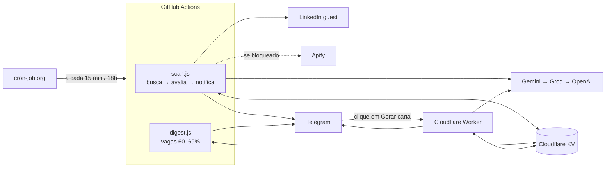

# Robô de vagas (telegram-recruiter) — documentação

A cada 15 minutos o robô busca vagas novas no LinkedIn, pede para uma IA comparar cada uma com o meu `perfil.md` e manda no Telegram as que passam de 70% de compatibilidade, com título, resumo, remuneração, link e um botão que gera a carta de apresentação. As vagas entre 60% e 69% vão para um resumo diário às 18h. O custo mensal é R$ 0.

> Para operar o robô no dia a dia (erros por serviço, troca de chaves, pausar e desligar), veja [INFRAESTRUTURA.md](INFRAESTRUTURA.md).

## Sumário

1. [Ferramentas](#1-ferramentas)
2. [Arquitetura](#2-arquitetura)
3. [Como funciona](#3-como-funciona)
4. [Configuração passo a passo](#4-configuração-passo-a-passo)
5. [Como construí este projeto](#5-como-construí-este-projeto)
6. [Ajustes](#6-ajustes)
7. [Troubleshooting](#7-troubleshooting)
8. [Segurança e limitações](#8-segurança-e-limitações)

---

## 1. Ferramentas

| Ferramenta | Papel | Custo |
|---|---|---|
| **GitHub Actions** | Roda a busca (`src/scan.js`) e o digest (`src/digest.js`). | Grátis em repositório público |
| **cron-job.org** | Dispara o GitHub a cada 15 min e às 18h. É mais pontual que o agendamento do próprio GitHub. | Grátis |
| **LinkedIn (endpoint guest)** | Fonte das vagas, sem login. Não é API oficial. | Grátis |
| **Apify** | Fonte reserva quando o LinkedIn bloqueia. | ~US$ 5/mês grátis |
| **Gemini 3.5 Flash-Lite** | IA principal: notas, resumo, salário e carta de apresentação. | Free tier |
| **Groq** | IA reserva, usada quando o Gemini falha. | Free tier |
| **OpenAI GPT-5 Nano** (opcional) | Último recurso, só quando o Gemini e o Groq falham. | Pago, com teto de US$ 2/mês |
| **Cloudflare Workers KV** | Memória do robô: vagas já vistas, vagas do digest, modo atual e gasto da OpenAI. | Grátis |
| **Cloudflare Worker** | Recebe o clique no botão "Gerar carta" e os comandos `/start` e `/status`. | Grátis |
| **Telegram** | Onde chegam as vagas, o digest e os alertas. | Grátis |

O Worker existe porque o GitHub Actions roda e termina; ele não fica no ar esperando cliques. Os dois usam o mesmo KV.

---

## 2. Arquitetura

### Visão geral



### Uma execução da busca


---

## 3. Como funciona

- **Busca:** são 11 buscas por execução, cruzando 3 grupos de termos (engenharia em inglês, IA em inglês e termos em português como "Desenvolvedor backend", "Desenvolvedor Node.js" e "Desenvolvedor IA") com 4 recortes: remoto no Brasil, remoto nos EUA, remoto em Portugal e São Paulo (presencial, híbrido ou remoto). Nos EUA só entram os termos em inglês e só a primeira página, porque a maioria dessas vagas exige morar lá e é eliminada pela IA. Cada busca pega as vagas da última hora. Como o robô roda a cada 15 min, cada vaga aparece em até 4 execuções seguidas, o que cobre eventuais falhas.
- **Pré-filtro:** antes de gastar IA, descarta a BairesDev e títulos de júnior, estágio, staff, diretoria, vendas e "AI trainer".
- **Deduplicação:** cada vaga ganha uma identidade (empresa + título normalizado) guardada por 30 dias. Repostagem com ID novo não chega duas vezes.
- **Avaliação:** a IA lê a vaga e o `perfil.md` e devolve:
  - **eliminatórios** (nota 0): exigir residência fora do Brasil (vale também para vagas remotas dos EUA e de Portugal), presencial ou híbrido fora da Grande São Paulo, stack totalmente diferente ou senioridade incompatível;
  - **notas de 0 a 100** em quatro critérios;
  - resumo, ponto de atenção e salário.

  A nota final é calculada **em código**, com pesos fixos, para a régua ser sempre a mesma.
- **Piso salarial:** só vale quando a vaga informa o salário. Os pisos são R$ 10k CLT e R$ 13k PJ ou moeda estrangeira (convertida pelo câmbio do dia). Sem salário informado, a IA estima, a mensagem marca "(estimativa IA)" e a vaga nunca é descartada pela estimativa.
- **Resiliência da IA:** em erros passageiros (503 ou 429), o robô tenta o mesmo modelo de novo depois de 8 s e de 20 s. Se continuar falhando, passa para o próximo provedor: Gemini → Groq → OpenAI. A OpenAI só é chamada se o pior caso da chamada couber no teto do mês.
- **Bloqueio do LinkedIn:** o robô troca sozinho para o Apify e avisa com "⚠️". Quando o LinkedIn volta, ele retoma a busca direta e avisa com "✅".
- **Botão "Gerar carta":** o Telegram avisa o Worker, que lê a vaga no KV e o `perfil.md` no GitHub, gera a carta no idioma da vaga e responde. Clicar de novo devolve a mesma carta, sem gastar IA.
- **Alertas:** quando a execução quebra, chega "🔴 Robô de vagas falhou", no máximo uma vez a cada 6h.
- **Garantia:** uma vaga só é marcada como vista depois que a mensagem é enviada. Se o Telegram falhar, ela é tentada de novo.

---

## 4. Configuração passo a passo

Tempo total: uns 60 minutos. Faça na ordem, porque alguns passos usam valores dos anteriores.

### 4.0 Antes de começar

Você vai criar contas nestes serviços (todas grátis): **GitHub**, **Telegram** (já tem), **Google AI Studio**, **Groq**, **Cloudflare**, **cron-job.org**. Opcionalmente, **Apify** e **OpenAI**.

Ao longo do caminho você vai juntar estes valores. Guarde num gerenciador de senhas, nunca num arquivo do projeto:

| Valor | Onde aparece | Usado em |
|---|---|---|
| Token do bot | @BotFather (4.2) | GitHub Secret + Worker |
| Chat ID | `getUpdates` (4.2) | GitHub Secret + `wrangler.toml` |
| Chave do Gemini | AI Studio (4.3) | GitHub Secret + Worker |
| Chave do Groq | console.groq.com (4.3) | GitHub Secret + Worker |
| Account ID da Cloudflare | URL do painel (4.4) | GitHub Secret |
| ID do namespace KV | URL do painel (4.4) | GitHub Secret + `wrangler.toml` |
| Token da API da Cloudflare | My Profile → API Tokens (4.4) | GitHub Secret |
| Segredo do webhook | você inventa (4.5) | Worker + comando `setWebhook` |
| URL do Worker | saída do `wrangler deploy` (4.5) | comando `setWebhook` |
| Token do Apify | Apify (4.6, opcional) | GitHub Secret |
| Chave da OpenAI | platform.openai.com (4.7, opcional) | GitHub Secret + Worker |
| Token do GitHub para o cron | Developer settings (4.10) | cron-job.org |

Você também precisa de **Node.js 20 ou mais novo** e do **git** instalados no computador.

### 4.1 Repositório no GitHub

1. Crie um repositório **público** (ex.: `telegram-recruiter`). Ele precisa ser público por dois motivos:
   - o GitHub Actions é ilimitado em repositórios públicos;
   - o Worker lê o `perfil.md` pelo link "raw".
2. Suba o projeto pelo terminal, de dentro da pasta dele:
   ```bash
   git init
   git add .
   git commit -m "Primeira versão"
   git branch -M main
   git remote add origin https://github.com/<seu-usuario>/telegram-recruiter.git
   git push -u origin main
   ```
3. Confira na aba **Code** do GitHub se estes itens subiram: a pasta **`.github`**, o **`.gitignore`** e o **`.env.example`**.

> ⚠️ **Arquivos ocultos no Mac.** Arquivos e pastas que começam com ponto ficam ocultos no Finder e costumam ficar de fora quando o projeto é enviado arrastando pelo navegador. Sem a pasta `.github`, a aba *Actions* mostra só "Get started with GitHub Actions". Para ver os ocultos no Finder, aperte **Cmd + Shift + .**. Prefira sempre subir com `git push`.

> ⚠️ **O `.env` nunca vai para o GitHub.** Ele está no `.gitignore`. Antes de cada `git add .`, rode `git status` e confira que o `.env` não aparece na lista. Também não cole chaves no `.env.example`, que é público.

### 4.2 Bot do Telegram

**Criar o bot e pegar o token**

1. No Telegram, procure **@BotFather**. É o bot oficial, com selo azul.
2. Mande `/newbot`.
3. Escolha um **nome** (ex.: `Robô de Vagas`) e depois um **usuário**, que precisa terminar em `bot` (ex.: `humberto_vagas_bot`).
4. O BotFather responde com o **token**, algo como `7123456789:AAH...xyz`.
   - Perdeu a mensagem? Mande `/mybots` → escolha o bot → **API Token**.

> ⚠️ **O token é a senha do bot.** Se ele aparecer num print ou num chat, mande `/revoke` para o @BotFather, gere outro e atualize o token em todos os lugares onde ele foi usado (Worker e GitHub).

**Descobrir o chat ID**

1. Abra a conversa com o **seu** bot e mande "oi". Ele não vai responder, e isso é normal: ainda não existe código rodando.
2. No navegador, abra `https://api.telegram.org/bot<TOKEN>/getUpdates`, trocando `<TOKEN>` pelo token, sem os `< >`.
3. Procure `"chat":{"id":123456789`. Esse número é o **chat ID**.
   - Se aparecer `"result":[]`, mande outro "oi" e recarregue a página.

> Faça isso **antes** do passo 4.5. Depois que o webhook é configurado, o `getUpdates` para de funcionar. Se precisar do chat ID depois, deixe `ALLOWED_CHAT_ID` vazio no `wrangler.toml`, publique o Worker e mande `/start` ao bot: ele responde com o número.

### 4.3 Chaves de IA

**Gemini (principal)**

1. Acesse [aistudio.google.com](https://aistudio.google.com) com a sua conta Google.
2. Clique em **Get API key → Create API key** e copie a chave.
3. Em **Rate limits**, confira quais modelos aparecem para a sua conta. O padrão do robô é `gemini-3.5-flash-lite`.

> O Google descontinua modelos com frequência. Se o log mostrar "is no longer available", troque o modelo pela variável `GEMINI_MODEL` (passo 4.8) e no `wrangler.toml`. Não precisa mexer no código.

**Groq (reserva)**

1. Acesse [console.groq.com](https://console.groq.com) (não pede cartão).
2. Vá em **API Keys → Create API Key** e copie a chave.

### 4.4 Cloudflare (KV)

1. Crie uma conta grátis em [dash.cloudflare.com](https://dash.cloudflare.com).
2. Vá em **Storage & Databases → Workers KV → Create namespace** e dê um nome (ex.: `telegram-recruiter`).
3. Abra o namespace criado. A URL do navegador já traz os dois IDs:
   ```
   https://dash.cloudflare.com/<ACCOUNT_ID>/workers/kv/namespaces/<ID_DO_NAMESPACE>
   ```
   - O primeiro trecho longo é o **Account ID** → Secret `CF_ACCOUNT_ID`.
   - O último trecho é o **ID do namespace** → Secret `CF_KV_NAMESPACE_ID` e campo `id` do `wrangler.toml`.
4. Crie o **token da API**:
   - Clique na sua foto (canto superior direito) → **My Profile → API Tokens → Create Token**.
   - Escolha **Create Custom Token**.
   - Em **Permissions**, escolha **Account** · **Workers KV Storage** · **Edit**.
   - Em **Account Resources**, escolha **Include** · a sua conta.
   - Clique em **Continue to summary → Create Token** e copie o token. Ele só aparece uma vez.

Os dois IDs não dão acesso a nada sozinhos. O **token**, sim: é uma senha.

### 4.5 Worker do botão "Gerar carta"

**1. Edite o `worker/wrangler.toml`:**

```toml
name = "telegram-recruiter"            # vira parte da URL do Worker

[[kv_namespaces]]
binding = "JOBS"
id = "<ID_DO_NAMESPACE>"               # o mesmo do passo 4.4

[vars]
ALLOWED_CHAT_ID = "<SEU_CHAT_ID>"      # passo 4.2
PROFILE_URL = "https://raw.githubusercontent.com/<seu-usuario>/telegram-recruiter/main/perfil.md"
GEMINI_MODEL = "gemini-3.5-flash-lite"
GROQ_MODEL = "openai/gpt-oss-120b"
DEDUP_DAYS = "30"
OPENAI_MODEL = "gpt-5-nano"
OPENAI_MONTHLY_BUDGET_USD = "2"
```

Para conferir o `PROFILE_URL`, abra o link no navegador: ele tem que mostrar o texto do `perfil.md`.

**2. Publique e configure os segredos.** No terminal, entre na pasta `worker` e rode **um comando por vez**:

```bash
npx wrangler login
```
Abre o navegador para autorizar. Volte ao terminal depois.

```bash
npx wrangler deploy
```
No final aparece a **URL do Worker**, no formato `https://telegram-recruiter.<seu-subdominio>.workers.dev`. Anote. Na primeira vez, a Cloudflare pode pedir para você escolher o subdomínio `workers.dev` da conta.

Agora os segredos. Cada comando mostra **"Enter a secret value"**: cole o valor e aperte Enter. O valor não aparece na tela, e isso é normal.

```bash
npx wrangler secret put TELEGRAM_BOT_TOKEN
```
Cole o token do bot.

```bash
npx wrangler secret put TELEGRAM_WEBHOOK_SECRET
```
Invente um texto aleatório, usando só letras, números, `_` e `-` (ex.: `vagas_9f3k2Lx81mQ`). Anote, porque ele vai no próximo comando.

```bash
npx wrangler secret put GEMINI_API_KEY
```
Cole a chave do Gemini.

```bash
npx wrangler secret put GROQ_API_KEY
```
Cole a chave do Groq.

> ⚠️ **Não cole vários comandos de uma vez.** Se um deles falhar, os seguintes rodam fora de ordem, e as linhas coladas podem entrar como valor de um segredo. Se algum segredo ficou errado, é só rodar o mesmo `secret put` de novo: ele sobrescreve o anterior.

**3. Ligue o Telegram ao Worker.** Monte o comando **numa linha só**, trocando os três valores entre `< >` (sem os sinais):

```bash
curl "https://api.telegram.org/bot<TOKEN>/setWebhook" -d "url=<URL_DO_WORKER>" -d "secret_token=<SEGREDO_DO_WEBHOOK>" -d 'allowed_updates=["message","callback_query"]'
```

A resposta esperada é `{"ok":true,"result":true,"description":"Webhook was set"}`.

**4. Teste.** Abra a URL do Worker no navegador: deve aparecer `robo-vagas worker ok`. Depois mande `/start` ao bot: ele deve responder "Robô de vagas ativo ✅".

### 4.6 Apify (opcional, fonte reserva)

O Apify só é usado quando o LinkedIn bloqueia a busca direta. Sem ele, o robô só avisa do bloqueio e fica tentando o LinkedIn até ele voltar.

1. Crie a conta em [apify.com](https://apify.com). Dá para entrar com o Google, e não pede cartão.
2. No painel, vá em **Settings** (menu da esquerda, quase no fim) → aba **API & Integrations**.
3. Em **Personal API tokens**, copie o token *Default*. Ele começa com `apify_api_`.

### 4.7 OpenAI (opcional, último recurso pago)

1. Crie a conta em [platform.openai.com](https://platform.openai.com) e coloque **US$ 5 de crédito pré-pago**, com a **recarga automática desligada**. Assim, o prejuízo máximo possível é esse crédito.
2. Em **API keys → Create new secret key**, copie a chave.
3. Coloque a chave no Worker, de dentro da pasta `worker`:
   ```bash
   npx wrangler secret put OPENAI_API_KEY
   npx wrangler deploy
   ```
4. No GitHub, ela entra como Secret `OPENAI_API_KEY` (passo 4.8).

O robô controla o gasto sozinho: antes de cada chamada, ele confere se o pior caso cabe no teto de US$ 2 do mês. O gasto aparece no `/status` do bot.

### 4.8 Secrets e Variables do GitHub

Abra o repositório no GitHub → **Settings** (a aba do repositório, não a do seu perfil) → **Secrets and variables → Actions**.

**Aba Secrets** → **New repository secret**. Crie um por um, com o nome **exatamente** igual à tabela:

| Name | Valor |
|---|---|
| `TELEGRAM_BOT_TOKEN` | token do bot |
| `TELEGRAM_CHAT_ID` | chat ID |
| `CF_ACCOUNT_ID` | Account ID da Cloudflare |
| `CF_KV_NAMESPACE_ID` | ID do namespace KV |
| `CF_API_TOKEN` | token da API da Cloudflare |
| `GEMINI_API_KEY` | chave do Gemini |
| `GROQ_API_KEY` | chave do Groq |
| `APIFY_TOKEN` | token do Apify (se criou) |
| `OPENAI_API_KEY` | chave da OpenAI (se criou) |

**Aba Variables** → **New repository variable**. São opcionais e não são senhas:

| Name | Valor | Para quê |
|---|---|---|
| `GEMINI_MODEL` | `gemini-3.5-flash-lite` | Trocar o modelo sem mexer no código. Aceita uma lista separada por vírgula. |
| `GROQ_MODEL` | `openai/gpt-oss-120b` | Idem, para o Groq |
| `OPENAI_MODEL` | `gpt-5-nano` | Idem, para a OpenAI |
| `LOG_JOBS` | `1` | O log mostra título, empresa e nota de cada vaga. Útil para calibrar, mas o log é público. |

Os nomes de *Variables* vão na aba **Variables**. Se forem criados em *Secrets*, o workflow não encontra.

### 4.9 Primeira execução

1. No GitHub, abra a aba **Actions**. No menu da esquerda devem aparecer **Buscar vagas**, **Digest diário** e **Testes**.
2. Clique em **Buscar vagas → Run workflow → Run workflow** (botão verde), deixando a branch `main`.
3. Clique na execução que aparecer na lista, depois em **scan**, depois na etapa **Buscar, avaliar e notificar**.
4. O log fica quieto por 1 a 2 minutos durante as buscas, e isso é normal. A primeira execução varre as últimas 24h e leva de 3 a 8 minutos.
5. No final, procure a linha:

```
Resumo: {"recebidas":148,"prefiltradas":17,"repetidas":34,"avaliadas":20,"enviadas":1,"quase":0,"descartadas":19,"adiadas":77,"erros":0,"bloqueio":null}
```

| Campo | Significa |
|---|---|
| `recebidas` | vagas que a busca encontrou |
| `prefiltradas` | descartadas pelo título ou pela empresa |
| `repetidas` | já avaliadas antes, ou repostagens |
| `avaliadas` | passaram pela IA (no máximo 20 por execução) |
| `enviadas` | chegaram no Telegram |
| `quase` | entre 60% e 69%; vão para o digest das 18h |
| `descartadas` | abaixo de 60%, eliminadas ou abaixo do piso |
| `adiadas` | ficaram para as próximas execuções |
| `erros` | se for maior que 0, leia as linhas com `!` logo acima |

Rode também **Digest diário → Run workflow** para validar. Se não houver vagas "quase" no dia, ele termina sem mandar nada.

### 4.10 cron-job.org (execução automática)

Sem este passo, o robô só roda quando você clica em *Run workflow*, ou uma vez por hora pelo agendamento reserva do GitHub, que costuma atrasar.

**A. Token do GitHub para o cron-job.org**

1. No GitHub, clique na sua foto → **Settings** (agora o da sua conta) → **Developer settings**, no fim do menu.
2. **Personal access tokens → Fine-grained tokens → Generate new token**.
3. Preencha:
   - **Token name:** `cron-job-robo`
   - **Expiration:** a maior opção disponível. Anote a data na agenda para renovar.
   - **Repository access:** *Only select repositories* → o seu repositório.
   - **Permissions → Repository permissions → Actions:** **Read and write**.
4. Clique em **Generate token** e copie o token (`github_pat_...`). Ele só aparece uma vez.

**B. Conta no cron-job.org**

1. Crie a conta em [cron-job.org](https://cron-job.org) e confirme o e-mail.
2. Em **Settings**, ajuste o **Timezone** para `America/Sao_Paulo`.

**C. Job 1 — Buscar vagas (a cada 15 min)**

Clique em **Create cronjob**.

Aba **Common**:
- **Title:** `Buscar vagas`
- **URL:** `https://api.github.com/repos/<seu-usuario>/telegram-recruiter/actions/workflows/scan.yml/dispatches`
- **Execution schedule:** *Every 15 minutes*
- Ligue **Save responses in job history**. Com isso, você vê a resposta do GitHub quando algo der errado.

Aba **Advanced**:
- **Request method:** `POST`
- **Headers** (um por linha, com *Add header*):

  | Nome | Valor |
  |---|---|
  | `Authorization` | `Bearer github_pat_...` (a palavra Bearer, um espaço e o token) |
  | `Accept` | `application/vnd.github+json` |
  | `X-GitHub-Api-Version` | `2022-11-28` |
  | `User-Agent` | `robo-vagas-cron` |
  | `Content-Type` | `application/json` |

- **Request body:** `{"ref":"main"}`

Aba **Notifications:** ligue o aviso por e-mail quando a execução falhar.

Clique em **Test run**. O esperado é **HTTP 204** (resposta vazia), e uma execução nova aparece em *Actions* no GitHub. Se der certo, clique em **Create**.

> ⚠️ **"This URL does not look to be valid":** quase sempre é um espaço invisível no começo ou no fim da URL, vindo da cópia. Apague o campo e cole de novo, conferindo as pontas.

**D. Job 2 — Digest diário (18h)**

Repita o job 1, com três diferenças:
- **Title:** `Digest diário`
- **URL:** a mesma, trocando `scan.yml` por `digest.yml`
- **Execution schedule:** *Every day at* `18:00`

**E. Se o Test run não der 204**

| Resposta | Causa | Solução |
|---|---|---|
| 401 | Token errado, ou falta `Bearer ` antes dele | Confira o header `Authorization` |
| 403 | Token sem permissão de Actions | Edite o token: *Actions: Read and write* |
| 404 | URL errada, ou o token não tem acesso ao repositório | Confira usuário, repositório e nome do `.yml`, e o *Repository access* do token |
| 422 | Body errado ou branch diferente de `main` | O body deve ser exatamente `{"ref":"main"}` |

### 4.11 Rodar no próprio computador (opcional)

Serve para testar o parser e a régua sem enviar nada:

```bash
npm test                          # testes offline, sem rede
cp .env.example .env              # preencha pelo menos GEMINI_API_KEY no .env
set -a && source .env && set +a
DRY_RUN=1 LOG_JOBS=1 npm run scan
```

Com `DRY_RUN=1`, as mensagens aparecem no terminal em vez do Telegram, e nada é gravado no KV.

> No Mac, se o terminal do VS Code mostrar **"Operation not permitted"** ao mexer em arquivos da pasta Downloads, é a proteção de privacidade do macOS. Arraste os arquivos pela barra lateral do VS Code, ou libere em *Ajustes do Sistema → Privacidade e Segurança → Arquivos e Pastas → Visual Studio Code → Pasta Downloads*.

---

## 5. Como construí este projeto

Esta seção conta o projeto como eu explicaria numa entrevista ou para outro dev: o problema, as decisões e o que aprendi.

### Em 30 segundos

> "Montei um agente que monitora o LinkedIn a cada 15 minutos, usa um LLM para medir a compatibilidade de cada vaga com o meu currículo numa régua fixa e me manda no Telegram só as que passam de 70%, com resumo, salário e um botão que gera a carta de apresentação. Roda 100% em free tiers (GitHub Actions, Cloudflare Workers e KV, Gemini), tem fallback em cada camada (LinkedIn → Apify, Gemini → Groq → OpenAI com teto de US$ 2/mês) e é coberto por testes automatizados sem dependências externas."

### Etapa 1 — O problema

Buscar vaga no LinkedIn é repetitivo: os alertas nativos trazem muita coisa irrelevante, e as boas vagas recebem centenas de candidaturas nas primeiras horas. Eu queria ser avisado **cedo** e só das vagas que realmente combinam comigo: remotas ou híbridas em SP, pleno/sênior, back-end e IA, acima de um piso salarial.

### Etapa 2 — Requisitos antes do código

A ideia veio de um vídeo que fazia algo parecido com n8n numa VPS paga. Antes de escrever código, passei por uma sessão de perguntas e respostas com um assistente de IA (Claude) para fechar cada decisão: onde roda, de onde vêm as vagas, qual LLM, quais filtros, o que é "70% de compatibilidade", o que fazer com salário ausente, como evitar repetição, o que acontece quando algo falha. O mesmo assistente me ajudou a implementar e a debugar.

As principais decisões, com o porquê de cada uma:

| Decisão | Por quê |
|---|---|
| Node.js no GitHub Actions, em vez de n8n numa VPS | Custo zero, sem servidor para manter, versionado e na minha stack principal |
| Repositório público | Minutos ilimitados no Actions. O perfil já é público no LinkedIn. |
| Busca a cada 15 min, disparada pelo cron-job.org | O agendamento do GitHub atrasa 10 a 30 min; o cron-job.org é pontual |
| Régua com eliminatórios e pesos fixos | Pedir só "dê uma nota" gera números inconsistentes |
| Salário estimado nunca descarta vaga | Estimativa de LLM é um chute, não um dado |

### Etapa 3 — Coleta das vagas

O LinkedIn não tem API pública de vagas. Usei o endpoint "guest", o mesmo que a página de vagas usa sem login. Ele devolve HTML, então escrevi um parser com expressões regulares e sem dependências.

Para não multiplicar as requisições, juntei os termos com `OR` em 3 grupos e cruzei com 4 recortes de localização: 11 buscas por execução (cada recorte pode limitar quais grupos usa e quantas páginas lê). Cada busca pega a última hora. Com execuções a cada 15 min, cada vaga aparece em até 4 execuções, então uma falha isolada não perde nada.

O robô detecta bloqueio pelos códigos de resposta do LinkedIn (429, 999 e redirecionamento para login) e troca para o Apify, um scraper pago com proxies próprios. Para economizar os créditos grátis, o Apify roda só a cada 2h. Em toda execução, o robô faz uma requisição de teste ao LinkedIn e volta para ele assim que é liberado.

### Etapa 4 — Filtrar antes de gastar

A IA é o recurso mais caro e mais limitado, então tudo o que pode ser descartado antes dela é descartado:

1. **Pré-filtro por regex** no título e na empresa: júnior, staff, vendas, BairesDev.
2. **Deduplicação por "fingerprint":** um hash de empresa + título normalizado (sem acento, sem parênteses e sem palavras como *remote*, *LATAM* e *PJ*). Isso pega repostagens que voltam com ID novo.

Na primeira execução real, de 148 vagas encontradas, 51 morreram nesses dois filtros sem custar nada.

### Etapa 5 — Avaliação com IA

O prompt manda o meu perfil, a vaga e a régua, e pede um JSON. A decisão principal foi **separar o julgamento do cálculo**:

- O **LLM** faz o que ele faz bem: ler a vaga e dar notas por critério (stack, tipo de trabalho, experiência e outros), apontar eliminatórios, resumir e estimar o salário.
- O **código** calcula a nota final com pesos fixos (40/25/20/15), aplica o piso salarial convertendo moedas e decide o destino.

Assim o corte de 70% é sempre o mesmo, e eu consigo testar a régua sem chamar a IA.

### Etapa 6 — Resiliência

Cada camada tem um plano B, porque serviços grátis falham:

- **IA:** tentativa de novo com espera crescente em erros passageiros, depois Gemini → Groq → OpenAI. A OpenAI tem um **teto de US$ 2/mês** controlado pelo próprio robô: antes de cada chamada, ele calcula o custo no pior caso e só chama se couber no que sobra do mês; depois, soma o custo real informado pela API.
- **Fonte:** LinkedIn → Apify, com volta automática.
- **Entrega:** a vaga só é marcada como vista depois que a mensagem sai. Se o Telegram falhar, ela é tentada na próxima execução.
- **Observabilidade:** cada execução termina com uma linha `Resumo:` com as contagens, e os erros geram um alerta no Telegram com intervalo mínimo de 6h, para não virar spam.

### Etapa 7 — Interação pelo Telegram

O botão "Gerar carta" exigia algo sempre no ar, e o GitHub Actions não é isso. Criei um Cloudflare Worker que recebe o webhook do Telegram, responde 200 na hora e gera a carta em segundo plano. O Worker lê a vaga no mesmo KV do robô e guarda a carta para que um segundo clique não gaste IA.

Por segurança, o Worker só aceita requisições com o segredo do webhook e só responde ao meu chat ID. Ninguém consegue usar o bot para gastar as minhas cotas.

### Etapa 8 — Estado e memória

O Cloudflare Workers KV guarda as vagas vistas (com expiração de 30 dias), as vagas do digest, o modo atual (LinkedIn ou Apify) e o gasto do mês com a OpenAI. O robô acessa o KV pela API REST, porque roda no GitHub, e o Worker acessa pelo binding nativo. O limite grátis que mais importa é o de 1.000 gravações por dia. A primeira versão gravava uma vez por vaga avaliada e chegou a 90% do limite diário já no segundo dia (veja a etapa 10). Hoje, as vagas vistas ficam numa lista por dia (`vistas:<data>`), gravada uma vez por execução, e só as vagas enviadas ganham registro próprio, que o botão de carta usa.

### Etapa 9 — Testes

São 30 testes com `node:test`, sem nenhuma dependência npm e sem rede:
- **Parser:** usa fixtures que reproduzem o HTML do LinkedIn.
- **Régua:** pesos, eliminatórios e classificação.
- **Salário:** conversão de moeda, piso e formatação.
- **Deduplicação.**
- **Pipeline completo:** com LLM e Telegram falsos.
- **Troca de fonte:** bloqueio → Apify → volta.
- **Tentativas e fallback da IA.**
- **Teto da OpenAI.**

Antes de ir ao ar, também testei o Worker com o Telegram, o KV e o LLM simulados.

### Etapa 10 — Problemas reais que resolvi

| Problema | Como apareceu | Solução |
|---|---|---|
| Modelo do Gemini descontinuado | `404: no longer available to new users` na primeira execução | Modelo configurável por variável, sem mexer no código; modelo que responde 404 é desligado pelo resto da execução |
| Gemini sobrecarregado | `503 high demand` em várias vagas seguidas | Tentativa de novo com espera crescente e lista de modelos |
| Groq estourando o limite | `429` ao assumir muitas vagas seguidas | Tentativa de novo respeitando o tempo de espera pedido pela API, e a OpenAI com teto como última camada |
| KV perto do limite diário | E-mail da Cloudflare: 90% das 1.000 gravações diárias usadas no segundo dia | Uma gravação por vaga virou uma por execução (lista diária de vistas); também cortei termos genéricos e ampliei o pré-filtro |
| Workflows invisíveis no GitHub | A aba *Actions* mostrava só "Get started" | A pasta `.github` é oculta no Mac e não tinha subido |
| Filtros ignorados pelo LinkedIn | Vagas fora do recorte chegando à avaliação | O LLM confere de novo local e modelo de trabalho e elimina o que não serve |

### Etapa 11 — Números

- **Primeira execução:** 194 vagas nas últimas 24h.
- **Execução típica:** cerca de 150 vagas encontradas, das quais aproximadamente 1/3 morre no pré-filtro e na deduplicação.
- **Duração de uma execução:** cerca de 4,5 minutos, dentro do intervalo de 15.
- **Custo:** R$ 0 por mês, com teto de US$ 2 se a camada paga for acionada.

### Etapa 12 — Próximos passos

- Botões 👍/👎 nas mensagens, para calibrar os pesos com o meu feedback real.
- Um painel com as vagas avaliadas e as candidaturas feitas.
- Rodar a busca de um IP residencial, se o bloqueio do LinkedIn virar rotina.

---

## 6. Ajustes

Quase tudo fica em `config/config.json`:

| O que mudar | Onde |
|---|---|
| Termos e locais | `search.keywordGroups` e `search.locations`. Junte termos com `OR` em vez de criar grupos, porque cada grupo novo soma uma busca por local. Num local, `groups` limita quais grupos ele usa e `maxPages` limita as páginas. `workplaceTypes`: `1` presencial, `2` remoto, `3` híbrido. |
| Empresas e títulos excluídos | `filters.excludedCompanies` e `filters.excludedTitlePatterns` (expressões regulares; hoje cobrem nível, outras stacks como Java/.NET/PHP/mobile/front-end, QA, DevOps, suporte, design, dados, gestão e vendas) |
| Nota de corte e do digest | `scoring.sendThreshold` (70) e `scoring.digestThreshold` (60) |
| Pesos da nota | `scoring.weights` |
| Pisos salariais | `salary.floorsBRLMonthly` |
| Vagas avaliadas por execução | `llm.maxEvaluationsPerRun` (20) |
| Teto da OpenAI | `openai.monthlyBudgetUSD` no `config.json` **e** `OPENAI_MONTHLY_BUDGET_USD` no `wrangler.toml`, com o mesmo valor |
| Frequência | Schedule do job no cron-job.org. Se passar de 1h, aumente `search.windowSeconds`. |
| Seu currículo e preferências | `perfil.md` |
| Critérios da IA | Prompt em `src/scoring.js` |

**Pausar:** desative os jobs no cron-job.org e os workflows em *Actions* (botão *Disable workflow*).
**Recomeçar do zero:** apague as chaves `state:*`, `vistas:*` e `vaga:*` no KV, pelo painel da Cloudflare.

**Limites que podem apertar:**
- **KV:** 1.000 gravações por dia. O robô usa cerca de 150 a 250: uma por execução, mais uma por vaga enviada ou "quase".
- **Gemini:** a cota diária grátis. Cada vaga nova que passa do pré-filtro é uma chamada. Se a cota acabar com frequência, reduza termos ou locais (os EUA são o primeiro candidato) ou acrescente palavras ao pré-filtro.

---

## 7. Troubleshooting

| Sintoma | Causa provável | Solução |
|---|---|---|
| Nada chega | — | Veja a linha `Resumo:` no log. `recebidas: 0` → nenhuma vaga ou HTML mudou. `enviadas: 0` → nenhuma passou de 70% (ligue `LOG_JOBS=1`). `erros > 0` → leia as linhas com `!`. |
| *Actions* mostra "Get started with GitHub Actions" | A pasta `.github` não subiu | Veja o aviso de arquivos ocultos no passo 4.1 |
| Workflow não roda a cada 15 min | cron-job.org | Veja o histórico do job e a tabela do passo 4.10-E |
| "Variáveis de ambiente faltando" | Secret ausente ou com nome diferente | Confira os nomes exatos no passo 4.8 |
| ⚠️ Bloqueio do LinkedIn todo dia | Requisições demais | Rode a cada 30 min, use `maxPagesPerQuery` 1 ou 2, remova locais ou aumente `requestDelayMs` |
| Apify HTTP 402 ou 403 | Créditos do mês acabaram | Aguarde o LinkedIn voltar ou o mês virar |
| Apify HTTP 400 ou vagas sem título | Actor mudou o formato | Ajuste `searchApify` e `mapApifyItem` em `src/apify.js` |
| Sempre 0 vagas, sem bloqueio | HTML do LinkedIn mudou | Baixe uma busca com `curl` e ajuste os regex de `parseSearchResults` em `src/linkedin.js` |
| `Gemini 404 ... no longer available` | Modelo descontinuado | Variável `GEMINI_MODEL` com o modelo indicado na mensagem, e o mesmo no `wrangler.toml` |
| `Gemini 503 high demand` | Google sobrecarregado | O robô já tenta de novo. Se for frequente, use uma lista em `GEMINI_MODEL` (ex.: `gemini-3.5-flash-lite,gemini-3.5-flash`). |
| `Gemini 429` | Cota esgotada | O Groq e depois a OpenAI assumem; sem eles, as vagas ficam para depois |
| `Groq 429` | Limite de tokens por minuto | Aumente `llm.groqMinIntervalMs` ou diminua `llm.maxDescriptionChars` |
| 💸 "Teto da OpenAI atingido" | US$ 2 gastos no mês | A OpenAI fica desligada até o mês virar. Se acontecer todo mês, investigue as falhas do Gemini no log. |
| `OpenAI HTTP 400` | Modelo não aceita `reasoning_effort` | Troque `openai.reasoningEffort` no `config.json` para `"low"` ou `""` |
| Notas altas ou baixas demais | Régua | Use o digest e o `LOG_JOBS=1` para calibrar; ajuste `sendThreshold`, os pesos ou o `perfil.md` |
| Vaga repetida | Título repostado diferente | Acrescente palavras em `TITLE_NOISE` (`src/util.js`) |
| Botão não responde | Webhook | `curl "https://api.telegram.org/bot<TOKEN>/getWebhookInfo"`. 401 → segredo diferente nos dois lados. Use `npx wrangler tail` para ver os logs. |
| "Não autorizado." | `ALLOWED_CHAT_ID` errado | Corrija no `wrangler.toml` e rode `npx wrangler deploy` |
| "Não encontrei os dados dessa vaga" | Vaga com mais de 30 dias, ou KV diferente | Confira se o ID do KV é o mesmo no Worker e no GitHub |
| "Não consegui ler o perfil" | `PROFILE_URL` errado ou repositório privado | Abra o link no navegador |
| Digest não chega | Nenhuma vaga entre 60% e 69% no dia | É normal. O log mostra `0 vagas "quase"`. |
| KV HTTP 429, ou e-mail "KV daily operation limit" da Cloudflare | Mais de 1.000 gravações no dia | Confira em *View usage* qual operação estourou. Gravações: veja se as execuções estão gravando `vistas:<data>` só uma vez (1 gravação por execução). O contador zera às 21h de Brasília. |
| KV HTTP 403 | Token da Cloudflare sem permissão | Recrie com *Workers KV Storage: Edit* |
| "Operation not permitted" no terminal | Privacidade do macOS | Veja o aviso no passo 4.11 |
| Aviso "Node.js 20 is deprecated" | Actions em versão antiga | Use `actions/checkout@v5` e `actions/setup-node@v5` nos workflows |
| Agendamento do GitHub desativado | 60 dias sem commit no repositório | Reative em *Actions*. O cron-job.org não é afetado. |

---

## 8. Segurança e limitações

- **Chaves:** ficam só nos Secrets do GitHub e nos segredos do Worker. O `perfil.md` e os logs do Actions são públicos, por isso o perfil não tem telefone nem e-mail, e o `LOG_JOBS` deve ficar ligado só para calibrar.
- **Bot:** só responde ao meu chat ID e exige o segredo do webhook.
- **Token do cron-job.org:** só tem acesso a este repositório e só para disparar workflows.
- **OpenAI:** usa crédito pré-pago sem recarga automática, além do teto mensal no código.
- **Termos de uso:** raspar o LinkedIn fere os termos dele. O risco é bloqueio de IP, não da conta, porque o robô não faz login.
- **"Assim que surgir"** significa até ~15 min depois da publicação, porque o LinkedIn não avisa quando uma vaga sai.
- **IPs de datacenter:** se os IPs do GitHub forem bloqueados com frequência, o mesmo código roda no próprio computador (`npm run scan` agendado), com o mesmo Worker e o mesmo KV.
