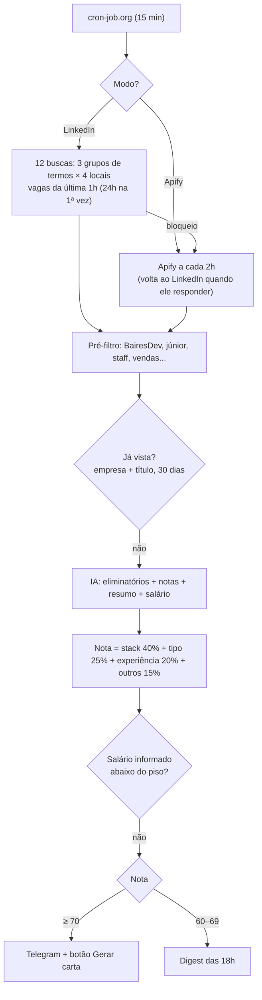

# Robô de vagas — documentação

A cada 15 min o robô busca vagas novas no LinkedIn, pede para uma IA comparar cada uma com o `perfil.md` e manda no Telegram as que passam de 70%. As que ficam entre 60% e 69% vão para um resumo diário às 18h. O custo é R$ 0.

## 1. Ferramentas

| Ferramenta | Papel |
|---|---|
| **GitHub Actions** | Roda a busca (`src/scan.js`) e o digest (`src/digest.js`). Repositório público tem minutos ilimitados. |
| **cron-job.org** | Dispara o GitHub a cada 15 min e às 18h, mais pontual que o agendamento do próprio GitHub. |
| **LinkedIn (endpoint guest)** | Fonte das vagas, sem login. Não é API oficial. |
| **Apify** | Fonte reserva quando o LinkedIn bloqueia. Usa os ~US$ 5 grátis por mês. |
| **Gemini Flash-Lite / Groq** | IA que dá as notas, o resumo e o salário, e escreve a carta. O Groq só entra se o Gemini falhar. |
| **OpenAI GPT-5 Nano (opcional)** | Último recurso, só usado se o Gemini e o Groq falharem. É pago, com teto de **US$ 2/mês** controlado pelo robô. |
| **Cloudflare Workers KV** | Memória do robô: vagas já vistas, vagas do digest e modo atual. |
| **Cloudflare Worker** | Recebe o clique no botão "Gerar carta" e os comandos `/start` e `/status`. |
| **Telegram** | Onde chegam as vagas, o digest e os alertas. |

O Worker existe porque o GitHub Actions não fica no ar esperando cliques. Os dois usam o mesmo KV.

## 2. Como funciona



- **Eliminatórios (nota 0):** exigir residência fora do Brasil; ser presencial ou híbrido fora de SP; stack totalmente diferente; senioridade incompatível.
- **Piso salarial:** só vale quando a vaga informa o salário. Os pisos são R$ 10k CLT, R$ 13k PJ e R$ 13k para moeda estrangeira (convertida pelo câmbio do dia). Sem salário informado, a IA estima, a mensagem marca como "(estimativa IA)" e a vaga nunca é descartada pela estimativa.
- **Botão "Gerar carta":** o Telegram avisa o Worker, que lê a vaga no KV e o `perfil.md` no GitHub e responde com uma carta no idioma da vaga. Clicar de novo devolve a mesma carta.
- **Bloqueio do LinkedIn:** o robô troca sozinho para o Apify e avisa com "⚠️". Quando o LinkedIn volta, ele retoma a busca direta e avisa com "✅".
- **Erros:** chega "🔴 Robô de vagas falhou", no máximo uma vez a cada 6h.
- Uma vaga só é marcada como vista depois que a mensagem é enviada. Se o Telegram falhar, ela é tentada de novo.

## 3. Configuração (~40 min, nesta ordem)

1. **GitHub:** crie o repositório **público** `robo-vagas` e suba o projeto na branch `main`.
2. **Telegram:** fale com o @BotFather e use `/newbot` para pegar o **token**. Mande "oi" para o seu bot e abra `https://api.telegram.org/bot<TOKEN>/getUpdates` para achar o **chat ID** (`"chat":{"id":...}`).
3. **IA:** crie uma chave em [aistudio.google.com](https://aistudio.google.com) (Gemini) e outra em [console.groq.com](https://console.groq.com) (Groq).
4. **Cloudflare:** crie a conta. Em *Workers KV*, crie o namespace `robo-vagas` e copie o **ID**. Copie também o **Account ID**. Em *My Profile → API Tokens*, crie um token com a permissão **Account · Workers KV Storage · Edit**.
5. **Worker:** no `worker/wrangler.toml`, preencha o ID do KV, o `ALLOWED_CHAT_ID` (seu chat ID) e o `PROFILE_URL` (link raw do `perfil.md`). Depois rode:
   ```bash
   cd worker && npx wrangler login && npx wrangler deploy
   npx wrangler secret put TELEGRAM_BOT_TOKEN
   npx wrangler secret put TELEGRAM_WEBHOOK_SECRET   # qualquer texto aleatório
   npx wrangler secret put GEMINI_API_KEY
   npx wrangler secret put GROQ_API_KEY
   curl "https://api.telegram.org/bot<TOKEN>/setWebhook" -d "url=<URL do Worker>" \
     -d "secret_token=<o mesmo segredo>" -d 'allowed_updates=["message","callback_query"]'
   ```
   Para conferir, mande `/start` ao bot. A resposta deve ser "Robô de vagas ativo ✅".
6. **Apify (opcional):** crie a conta e copie o token em *Settings → API & Integrations*.
   **OpenAI (opcional):** crie uma chave em [platform.openai.com](https://platform.openai.com/api-keys) e coloque US$ 5 de crédito pré-pago, **com recarga automática desligada**. Coloque a chave no Worker (`npx wrangler secret put OPENAI_API_KEY`) e no GitHub (Secret `OPENAI_API_KEY`).
7. **Secrets do GitHub** (*Settings → Secrets and variables → Actions*): `TELEGRAM_BOT_TOKEN`, `TELEGRAM_CHAT_ID`, `CF_ACCOUNT_ID`, `CF_KV_NAMESPACE_ID`, `CF_API_TOKEN`, `GEMINI_API_KEY`, `GROQ_API_KEY`, `APIFY_TOKEN` e, se quiser o fallback pago, `OPENAI_API_KEY`. Variáveis opcionais: `GEMINI_MODEL`, `GROQ_MODEL`, `OPENAI_MODEL` e `LOG_JOBS=1` (mostra as notas no log, que é público).
8. **Teste:** em *Actions → Buscar vagas → Run workflow*, confira a linha `Resumo:` no log.
9. **cron-job.org:**
   - Crie um token *fine-grained* no GitHub, só para o `robo-vagas`, com a permissão **Actions: Read and write**.
   - Crie dois jobs, com o fuso America/Sao_Paulo:
     - **Busca:** `POST https://api.github.com/repos/<usuario>/robo-vagas/actions/workflows/scan.yml/dispatches`, a cada 15 min.
     - **Digest:** a mesma URL com `digest.yml`, todo dia às 18:00.
   - Nos dois, use os headers `Authorization: Bearer <token>`, `Accept: application/vnd.github+json` e `User-Agent: robo-vagas-cron`, e o body `{"ref":"main"}`.
   - O teste no cron-job.org deve devolver **204**.

**Teste local:** `npm test` roda os testes sem rede. `DRY_RUN=1 LOG_JOBS=1 npm run scan` faz a busca real, mas mostra as mensagens no terminal em vez de mandar ao Telegram e não grava nada no KV.

## 4. Ajustes

Quase tudo fica em `config/config.json`:

| O que mudar | Onde |
|---|---|
| Termos e locais | `search.keywordGroups` e `search.locations`. Junte termos com `OR` em vez de criar grupos, porque cada grupo novo soma 4 buscas. |
| Empresas e títulos excluídos | `filters.excludedCompanies` e `filters.excludedTitlePatterns` |
| Nota de corte e do digest | `scoring.sendThreshold` (70) e `scoring.digestThreshold` (60) |
| Pesos da nota | `scoring.weights` |
| Pisos salariais | `salary.floorsBRLMonthly` |
| Vagas avaliadas por execução | `llm.maxEvaluationsPerRun` (20) |
| Teto da OpenAI | `openai.monthlyBudgetUSD` (2) no `config.json` **e** `OPENAI_MONTHLY_BUDGET_USD` no `wrangler.toml`, com o mesmo valor. O gasto do mês aparece no `/status` do bot. |
| Frequência | Schedule no cron-job.org. Se passar de 1h, aumente `search.windowSeconds`. |
| Seu currículo e preferências | `perfil.md` |
| Critérios da IA | Prompt em `src/scoring.js` |

**Pausar:** desative os jobs do cron-job.org e os workflows em *Actions*.
**Recomeçar do zero:** apague as chaves `state:*` e `vaga:*` no KV.

**Limites que podem apertar:** 1.000 gravações por dia no KV (uma por vaga avaliada) e a cota diária do Gemini. Só chegam perto se entrarem centenas de vagas novas por dia.

## 5. Troubleshooting

| Sintoma | Causa provável | Solução |
|---|---|---|
| Nada chega | — | Veja a linha `Resumo:` no log. `recebidas: 0` → nenhuma vaga ou HTML mudou. `enviadas: 0` → nenhuma passou de 70% (ligue `LOG_JOBS=1`). `erros > 0` → leia as linhas com `!`. |
| Workflow não roda a cada 15 min | cron-job.org | Veja o histórico do job. 401 → token expirado. 403 → falta permissão de Actions. 404 → URL errada ou token sem acesso ao repositório. 422 → branch errada no body. |
| "Variáveis de ambiente faltando" | Secret ausente | Confira os nomes exatos no passo 7. |
| ⚠️ Bloqueio do LinkedIn todo dia | Muitas requisições | Rode a cada 30 min, use `maxPagesPerQuery` 1 ou 2, remova locais ou aumente `requestDelayMs`. |
| Apify HTTP 402 ou 403 | Créditos do mês acabaram | Aguarde o LinkedIn voltar ou o mês virar. |
| Apify HTTP 400 ou vagas sem título | Actor mudou o formato | Ajuste `searchApify` e `mapApifyItem` em `src/apify.js`. |
| Sempre 0 vagas, sem bloqueio | HTML do LinkedIn mudou | Baixe a busca com `curl` e ajuste os regex de `parseSearchResults` em `src/linkedin.js`. |
| `Gemini 429` | Cota esgotada | O Groq assume. Se os dois esgotarem, as vagas ficam para depois. |
| `Gemini 503 (high demand)` | Modelo sobrecarregado no Google | O robô tenta de novo 2x (8 s e 20 s). Se for frequente, use uma lista em `GEMINI_MODEL`, por exemplo `gemini-3.5-flash-lite,gemini-3.5-flash`. |
| `Gemini 404` ou `Groq 404` | Modelo descontinuado | Defina `GEMINI_MODEL` ou `GROQ_MODEL` com um modelo atual, no GitHub e no `wrangler.toml`. |
| 💸 "Teto da OpenAI atingido" | Gastou os US$ 2 do mês | A OpenAI fica desligada até o mês virar; o Gemini e o Groq seguem funcionando. Se acontecer todo mês, o Gemini está falhando demais: veja os erros dele no log. |
| `OpenAI HTTP 400` | Modelo não aceita `reasoning_effort` | Troque `openai.reasoningEffort` no `config.json` para `"low"` ou `""`. |
| Notas altas ou baixas demais | Régua | Use o digest para calibrar e ajuste `sendThreshold`, os pesos ou o `perfil.md`. |
| Vaga repetida | Título repostado diferente | Acrescente palavras em `TITLE_NOISE` (`src/util.js`). |
| Botão não responde | Webhook | Rode `getWebhookInfo`. 401 → o segredo é diferente nos dois lados. Use `npx wrangler tail` para ver os logs. |
| "Não autorizado." | `ALLOWED_CHAT_ID` errado | Corrija no `wrangler.toml` e rode `wrangler deploy`. |
| "Não encontrei os dados dessa vaga" | Vaga com mais de 30 dias, ou KV diferente | Confira se o ID do KV é o mesmo no Worker e no GitHub. |
| "Não consegui ler o perfil" | `PROFILE_URL` errado ou repositório privado | Abra o link no navegador. |
| Digest não chega | Nenhuma vaga entre 60% e 69% no dia | É normal. O log mostra `0 vagas "quase"`. |
| KV HTTP 429 | Passou de 1.000 gravações no dia | Reduza termos, locais ou `maxEvaluationsPerRun`. |
| KV HTTP 403 | Token da Cloudflare sem permissão | Recrie o token com *Workers KV Storage: Edit*. |
| Agendamento do GitHub desativado | 60 dias sem commit | Reative em *Actions*. O cron-job.org não é afetado. |

## 6. Segurança e limitações

- As chaves ficam nos Secrets do GitHub e do Worker. O `perfil.md` e os logs são públicos, por isso o perfil não tem telefone nem e-mail.
- O bot só responde ao seu chat ID e exige o segredo do webhook.
- Raspar o LinkedIn fere os termos de uso dele. O risco é bloqueio de IP, não da sua conta, porque o robô não faz login.
- "Assim que surgir" significa até ~15 min depois da publicação.
- Se os IPs do GitHub forem muito bloqueados, o mesmo código roda no seu computador (`npm run scan` agendado), com o mesmo Worker e o mesmo KV.
