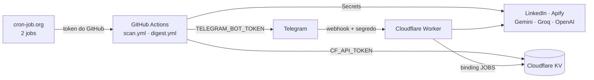

# Infraestrutura — configurações, erros, pausa e desligamento

Guia de operação do telegram-recruiter. Mostra onde fica cada configuração, como diagnosticar e corrigir erros em cada serviço, como trocar uma chave vazada, como pausar o robô por um tempo e como desligar tudo de vez.

Para entender o funcionamento e a configuração inicial, veja [DOCUMENTACAO.md](DOCUMENTACAO.md).

## Sumário

1. [Mapa das peças](#1-mapa-das-peças)
2. [Onde fica cada configuração](#2-onde-fica-cada-configuração)
3. [Checagem rápida de saúde](#3-checagem-rápida-de-saúde)
4. [Erros e correções por serviço](#4-erros-e-correções-por-serviço)
5. [Trocar uma chave (vazou ou expirou)](#5-trocar-uma-chave-vazou-ou-expirou)
6. [Pausar por um tempo](#6-pausar-por-um-tempo)
7. [Desligar para sempre](#7-desligar-para-sempre)

---

## 1. Mapa das peças



| Peça | O que faz | Se parar |
|---|---|---|
| **cron-job.org** | Dispara a busca a cada 15 min e o digest às 18h | A busca passa a rodar só 1x por hora (agendamento reserva do GitHub) |
| **GitHub Actions** | Executa o robô | Nada é buscado nem enviado |
| **Cloudflare KV** | Memória: vagas vistas, digest, modo, gasto da OpenAI | Mensagens repetidas, botão de carta sem dados |
| **Cloudflare Worker** | Botão "Gerar carta", `/start`, `/status` | Só o botão e os comandos param; as vagas continuam chegando |
| **Telegram** | Entrega das mensagens | Nada chega |
| **Gemini / Groq / OpenAI** | Avaliação das vagas e cartas | Um cobre o outro; se todos falharem, as vagas ficam para depois |
| **LinkedIn / Apify** | Fonte das vagas | Com o LinkedIn bloqueado, o Apify assume a cada 2h |

---

## 2. Onde fica cada configuração

### 2.1 Segredos e variáveis

| Item | GitHub Secret | GitHub Variable | Worker (segredo) | `wrangler.toml` | cron-job.org |
|---|:---:|:---:|:---:|:---:|:---:|
| Token do bot do Telegram | `TELEGRAM_BOT_TOKEN` | | `TELEGRAM_BOT_TOKEN` | | |
| Chat ID | `TELEGRAM_CHAT_ID` | | | `ALLOWED_CHAT_ID` | |
| Segredo do webhook | | | `TELEGRAM_WEBHOOK_SECRET` | | |
| Account ID da Cloudflare | `CF_ACCOUNT_ID` | | | | |
| ID do namespace KV | `CF_KV_NAMESPACE_ID` | | | `[[kv_namespaces]] id` | |
| Token da API da Cloudflare | `CF_API_TOKEN` | | | | |
| Chave do Gemini | `GEMINI_API_KEY` | | `GEMINI_API_KEY` | | |
| Chave do Groq | `GROQ_API_KEY` | | `GROQ_API_KEY` | | |
| Chave da OpenAI | `OPENAI_API_KEY` | | `OPENAI_API_KEY` | | |
| Token do Apify | `APIFY_TOKEN` | | | | |
| Modelo do Gemini | | `GEMINI_MODEL` | | `GEMINI_MODEL` | |
| Modelo do Groq | | `GROQ_MODEL` | | `GROQ_MODEL` | |
| Modelo da OpenAI | | `OPENAI_MODEL` | | `OPENAI_MODEL` | |
| Teto da OpenAI | | | | `OPENAI_MONTHLY_BUDGET_USD` | |
| Log detalhado | | `LOG_JOBS` | | | |
| Link do perfil | | | | `PROFILE_URL` | |
| Token do GitHub (fine-grained) | | | | | header `Authorization` |

Quando um item aparece em mais de uma coluna, **o valor precisa ser o mesmo nos dois lugares**. Ao trocar, troque em todos.

Onde mexer em cada lugar:
- **GitHub Secrets e Variables:** repositório → *Settings → Secrets and variables → Actions*.
- **Segredos do Worker:** pasta `worker`, comando `npx wrangler secret put NOME`. Vale na hora, sem precisar de deploy. Para ver quais existem: `npx wrangler secret list`.
- **`wrangler.toml`:** edite o arquivo e rode `npx wrangler deploy`. Aqui o deploy é obrigatório.
- **cron-job.org:** cada job → aba *Advanced* → *Headers*.

### 2.2 Ajustes de comportamento

Ficam em `config/config.json`, versionado no repositório. A mudança vale a partir da próxima execução depois do `git push`. A tabela completa está na seção "Ajustes" da [DOCUMENTACAO.md](DOCUMENTACAO.md).

### 2.3 Chaves no Cloudflare KV

| Chave | Conteúdo | Expira |
|---|---|---|
| `vistas:<AAAA-MM-DD>` | Vagas avaliadas no dia (uma gravação por execução) | 31 dias |
| `vaga:<fp>` | Registro das vagas enviadas, usado pelo botão de carta | 30 dias |
| `quase:<AAAA-MM-DD>:<fp>` | Vagas de 60–69% do digest | 3 dias |
| `state:mode` | Fonte atual (LinkedIn ou Apify) | nunca |
| `state:initialized` | Marca que a primeira execução (24h) já rodou | nunca |
| `state:lastErrorAlert` | Último alerta de erro enviado | 6h |
| `state:digest:<AAAA-MM-DD>` | Marca que o digest do dia já saiu | 2 dias |
| `state:openai:<AAAA-MM>` | Gasto do mês com a OpenAI | 40 dias |
| `state:openai-alerta:<AAAA-MM>` | Marca que o aviso de teto já foi enviado | 40 dias |

Para ver ou apagar: painel da Cloudflare → *Storage & Databases → Workers KV* → namespace → *KV Pairs*.

---

## 3. Checagem rápida de saúde

Use quando algo parecer estranho. Cada linha testa uma peça, do disparo até a entrega.

| # | O que checar | Como | Resultado esperado |
|---|---|---|---|
| 1 | cron-job.org disparando | Histórico do job "Buscar vagas" | HTTP **204** a cada 15 min |
| 2 | GitHub executando | *Actions → Buscar vagas* | Execuções verdes ✅ a cada ~15 min |
| 3 | Robô funcionando | Última execução → etapa "Buscar, avaliar e notificar" | Linha `Resumo:` com `erros: 0` |
| 4 | Worker no ar | Abrir a URL do Worker no navegador | `telegram-recruiter worker ok` |
| 5 | Webhook ligado | `curl "https://api.telegram.org/bot<TOKEN>/getWebhookInfo"` | `url` preenchida e sem `last_error_message` |
| 6 | Bot respondendo | Mandar `/status` ao bot | Fonte atual e gasto da OpenAI no mês |
| 7 | Cotas | Painel da Cloudflare → *Workers KV → Metrics*; AI Studio → *Rate limits* | KV com algumas centenas de gravações por dia; Gemini abaixo da cota diária |

---

## 4. Erros e correções por serviço

### 4.1 cron-job.org

O histórico de cada job mostra a resposta do GitHub. Deixe ligado **Save responses in job history** para ver o corpo da resposta.

| Resposta | Causa | Correção |
|---|---|---|
| 204 | Tudo certo | — |
| 401 Bad credentials | Token do GitHub errado, expirado ou sem `Bearer ` antes | Gere um token novo (seção 5) e atualize o header `Authorization` **dos dois jobs** |
| 403 Resource not accessible | Token sem permissão de Actions | Edite o token no GitHub: *Actions: Read and write* |
| 404 Not Found | URL errada, workflow renomeado ou token sem acesso ao repositório | Confira usuário, repositório e nome do `.yml` na URL, e o *Repository access* do token |
| 422 Unprocessable | Body errado ou branch inexistente | Body exatamente `{"ref":"main"}` |
| "This URL does not look to be valid" | Espaço invisível no começo ou no fim da URL | Apague o campo e cole de novo |
| Timeout ou erro de conexão | Instabilidade do GitHub ou do cron-job.org | Passageiro. O agendamento reserva do GitHub cobre a falha. |

O token do GitHub tem **data de validade**. Quando vencer, os dois jobs começam a dar 401. Deixe um lembrete na agenda.

### 4.2 GitHub Actions

| Sintoma | Causa | Correção |
|---|---|---|
| *Actions* mostra "Get started with GitHub Actions" | Pasta `.github/workflows` não está no repositório | Suba a pasta com `git add .github && git commit && git push`. No Mac ela é oculta: **Cmd + Shift + .** no Finder. |
| Workflow não aparece no menu | Arquivo `.yml` com erro de sintaxe | Abra o arquivo no GitHub: ele mostra o erro na linha |
| "Variáveis de ambiente faltando: ..." | Secret ausente ou com nome diferente | Crie o Secret com o nome exato da seção 2.1 |
| Variable ignorada (ex.: `GEMINI_MODEL`) | Criada na aba *Secrets* em vez de *Variables* | Recrie na aba **Variables** |
| Execução cancelada por tempo (12 min) | Muitas vagas com IA lenta, ou LinkedIn muito lento | Diminua `llm.maxEvaluationsPerRun` no `config.json` |
| Agendamentos param sozinhos | Repositório público sem commits por 60 dias | *Actions* → workflow → *Enable workflow*. Qualquer commit zera a contagem. O cron-job.org não é afetado. |
| Aviso "Node.js 20 is deprecated" | Actions na v4 | Use `actions/checkout@v5` e `actions/setup-node@v5` |
| Workflow "Testes" vermelho | Mudança quebrou algum teste | Rode `npm test` no computador e corrija antes do próximo push |

### 4.3 Cloudflare KV

| Sintoma | Causa | Correção |
|---|---|---|
| `Cloudflare KV ... HTTP 403` ou `Authentication error` | `CF_API_TOKEN` sem permissão, revogado ou de outra conta | Recrie o token com **Account · Workers KV Storage · Edit** e atualize o Secret |
| `Cloudflare KV ... HTTP 404` em todas as chaves | `CF_KV_NAMESPACE_ID` ou `CF_ACCOUNT_ID` errado | Copie de novo da URL do painel: `dash.cloudflare.com/<ACCOUNT_ID>/workers/kv/namespaces/<NAMESPACE_ID>` |
| `HTTP 429` ou e-mail "KV daily operation limit" | Estourou o limite grátis do dia (1.000 gravações, 1.000 listagens ou 100.000 leituras) | Em *View usage*, veja qual operação estourou. O contador zera às **21h de Brasília**. Se for gravação, confira se cada execução grava `vistas:<data>` só uma vez. |
| Vagas repetidas no Telegram | O KV não está gravando (cota ou token) | Corrija o erro de KV acima. Dá para pausar até as 21h (seção 6). |
| Robô "esqueceu" tudo e voltou a varrer 24h | Chave `state:initialized` apagada | Normal se foi de propósito. Se não, verifique quem mexeu no namespace. |

### 4.4 Cloudflare Worker (botão "Gerar carta")

Para ver os logs do Worker ao vivo: pasta `worker`, comando `npx wrangler tail`, e clique no botão.

| Sintoma | Causa | Correção |
|---|---|---|
| Botão não faz nada | Webhook não configurado ou apontando para outro lugar | Rode `getWebhookInfo` (seção 3) e refaça o `setWebhook` se a `url` estiver errada |
| `getWebhookInfo` mostra `Wrong response from the webhook: 401` | Segredo do webhook diferente nos dois lados | Defina o mesmo valor em `npx wrangler secret put TELEGRAM_WEBHOOK_SECRET` e no `secret_token` do `setWebhook` |
| `pending_update_count` alto | Worker fora do ar ou com erro | `npx wrangler deploy` de novo e veja o `wrangler tail` |
| "Não autorizado." | `ALLOWED_CHAT_ID` diferente do seu chat | Corrija no `wrangler.toml` e rode `npx wrangler deploy` |
| "Não encontrei os dados dessa vaga" | Vaga com mais de 30 dias, ou Worker ligado a outro KV | Confira se o `id` do `wrangler.toml` é igual ao `CF_KV_NAMESPACE_ID` |
| "Não consegui ler o perfil" | `PROFILE_URL` errado ou repositório privado | Abra o link no navegador. Ele precisa mostrar o texto do `perfil.md`. |
| "Não consegui gerar a carta agora" | Todas as IAs falharam | Veja o motivo na mensagem e na seção 4.6 |
| `wrangler deploy` pede login | Sessão do wrangler expirou | `npx wrangler login` |
| Mudou o `wrangler.toml` e nada mudou | Faltou publicar | Rode `npx wrangler deploy`. Segredos (`secret put`) valem na hora; as variáveis do `wrangler.toml` só depois do deploy. |

### 4.5 Telegram

| Sintoma | Causa | Correção |
|---|---|---|
| `Telegram HTTP 401` no log | Token do bot errado ou revogado | Atualize o token no GitHub Secret **e** no Worker |
| `Telegram HTTP 400: chat not found` | Chat ID errado, ou você nunca falou com o bot | Mande uma mensagem ao bot e confira o chat ID |
| `Telegram HTTP 403: bot was blocked by the user` | O bot foi bloqueado no Telegram | Desbloqueie o bot na conversa |
| `getUpdates` não mostra nada | Com o webhook ativo, o `getUpdates` não funciona | Use `/start` no bot com `ALLOWED_CHAT_ID` vazio para descobrir o chat ID |

### 4.6 Gemini, Groq e OpenAI

O robô tenta de novo nos erros passageiros e passa para o próximo provedor (Gemini → Groq → OpenAI). Só existe problema real quando **todos** falham.

| Mensagem no log | Causa | Correção |
|---|---|---|
| `Gemini HTTP 404 ... no longer available` | Modelo descontinuado | Variable `GEMINI_MODEL` com o modelo indicado na mensagem, e o mesmo no `wrangler.toml` |
| `Gemini HTTP 503 ... high demand` | Google sobrecarregado | Passageiro. Se for frequente, use uma lista em `GEMINI_MODEL` (ex.: `gemini-3.5-flash-lite,gemini-3.5-flash`). |
| `Gemini HTTP 429` | Cota por minuto ou diária esgotada | Por minuto: aumente `llm.geminiMinIntervalMs`. Diária: reduza o volume (termos, locais, pré-filtro). |
| `Gemini HTTP 400 ... API key not valid` | Chave errada ou apagada | Gere outra no AI Studio e atualize nos dois lugares |
| `Groq HTTP 429` ou `413` | Limite de tokens por minuto | Aumente `llm.groqMinIntervalMs` ou diminua `llm.maxDescriptionChars` |
| `Groq HTTP 404` / `model_decommissioned` | Modelo do Groq descontinuado | Variable `GROQ_MODEL` com um modelo atual de console.groq.com |
| `OpenAI HTTP 401` | Chave inválida | Gere outra e atualize nos dois lugares |
| `OpenAI HTTP 429 ... insufficient_quota` | Crédito pré-pago acabou | Coloque crédito, ou deixe sem: o Gemini e o Groq continuam funcionando |
| `OpenAI HTTP 400` | Modelo não aceita `reasoning_effort` | `openai.reasoningEffort` no `config.json` para `"low"` ou `""` |
| 💸 "Teto da OpenAI atingido" | US$ 2 gastos no mês | A OpenAI fica desligada até o mês virar. Se acontecer todo mês, o Gemini está falhando demais. |
| `Todos os provedores de LLM falharam` | Os três falharam na mesma vaga | As vagas ficam para as próximas execuções. Veja as linhas `!` acima para saber o motivo de cada um. |

### 4.7 LinkedIn e Apify

| Sintoma | Causa | Correção |
|---|---|---|
| ⚠️ "O LinkedIn bloqueou a busca direta" | IP do GitHub bloqueado (429, 999 ou login) | Automático: o Apify assume e o robô volta sozinho. Se for todo dia, rode a cada 30 min, use `maxPagesPerQuery` 1 ou 2, ou aumente `requestDelayMs`. |
| `Todas as 11 buscas no LinkedIn falharam` | Rede ou LinkedIn fora do ar | Passageiro. Se persistir, teste a URL de busca com `curl` no seu computador. |
| `recebidas: 0` sempre, sem bloqueio | HTML do LinkedIn mudou | Baixe uma busca com `curl` e ajuste os regex de `parseSearchResults` em `src/linkedin.js` |
| `Apify respondeu HTTP 402` ou `403` | Créditos do mês acabaram | Aguarde o LinkedIn voltar ou o mês virar |
| `Apify respondeu HTTP 400`, ou vagas sem título | O actor mudou o formato | Ajuste `searchApify` e `mapApifyItem` em `src/apify.js`, ou troque `apify.actorId` |
| "Modo Apify, mas APIFY_TOKEN não está configurado" | Sem o Secret do Apify | Crie o Secret, ou aceite ficar sem vagas até o LinkedIn voltar |

---

## 5. Trocar uma chave (vazou ou expirou)

Se uma chave apareceu num print, num chat ou num commit, **troque na hora**. Apagar o commit não basta: o histórico do Git e os forks guardam o valor.

| Chave | Gerar a nova | Atualizar em |
|---|---|---|
| Token do bot | @BotFather → `/revoke` → escolha o bot | GitHub Secret `TELEGRAM_BOT_TOKEN` + `npx wrangler secret put TELEGRAM_BOT_TOKEN` + refazer o `setWebhook` com o token novo |
| Segredo do webhook | Invente outro texto | `npx wrangler secret put TELEGRAM_WEBHOOK_SECRET` + refazer o `setWebhook` |
| Token da API da Cloudflare | *My Profile → API Tokens* → token → **Roll** | GitHub Secret `CF_API_TOKEN` |
| Chave do Gemini | AI Studio → *API keys* → crie outra e apague a antiga | GitHub Secret + `npx wrangler secret put GEMINI_API_KEY` |
| Chave do Groq | console.groq.com → *API Keys* → crie outra e apague a antiga | GitHub Secret + `npx wrangler secret put GROQ_API_KEY` |
| Chave da OpenAI | platform.openai.com → *API keys* → crie outra e revogue a antiga | GitHub Secret + `npx wrangler secret put OPENAI_API_KEY` |
| Token do Apify | Apify → *Settings → API & Integrations* → crie outro e apague o antigo | GitHub Secret `APIFY_TOKEN` |
| Token do GitHub (cron) | GitHub → *Settings → Developer settings → Fine-grained tokens* → **Regenerate** | Header `Authorization` dos **dois** jobs no cron-job.org |

Depois de trocar, faça a checagem da seção 3.

---

## 6. Pausar por um tempo

Use quando quiser parar de receber vagas por alguns dias (férias, já está em processo seletivo etc.) sem desmontar nada.

### Para pausar

1. **cron-job.org:** desligue os dois jobs ("Buscar vagas" e "Digest diário") no botão de ativar do job.
2. **GitHub:** *Actions* → **Buscar vagas** → botão **⋯** → **Disable workflow**. Repita para **Digest diário**. Sem isso, o agendamento reserva continua rodando 1x por hora.

Isso basta. O resto pode ficar como está:
- O **Worker** continua no ar: o botão de carta das vagas antigas e o `/status` seguem funcionando, e ele não gasta nada parado.
- O **KV** não consome nada parado. As vagas vistas continuam valendo até expirarem (30 dias).
- **Gemini, Groq, OpenAI e Apify** não cobram nada parados.

### Para voltar

1. **GitHub:** *Actions* → cada workflow → **Enable workflow**.
2. **cron-job.org:** ligue os dois jobs de novo.
3. Confira que a próxima execução ficou verde (seção 3).

**Recuperar as vagas do período parado:** o robô normalmente olha só a última hora. Para ele varrer as **últimas 24h** na primeira execução depois da volta, apague a chave `state:initialized` no KV antes de religar. Mais de 24h para trás ele não busca.

**Se a pausa passar de 30 dias:** as vagas vistas expiram e algumas vagas antigas, se ainda estiverem no ar e forem repostadas, podem chegar de novo. Na prática isso acontece pouco, porque o robô só busca vagas recentes.

### Alternativa: pausar só o Telegram

Se você quer que o robô continue avaliando e registrando, mas sem receber mensagens, silencie a conversa com o bot no Telegram. Não desligue nada.

---

## 7. Desligar para sempre

Faça **na ordem**: primeiro pare o que dispara, depois revogue os acessos e por último apague os dados. Assim nada fica rodando com chave quebrada nem gerando erro.

### 7.1 Parar os disparos

1. **cron-job.org:** apague os dois jobs. Se não for usar mais o serviço, apague a conta em *Settings*.
2. **GitHub Actions:** desative os três workflows (*Actions* → workflow → **⋯** → **Disable workflow**).

### 7.2 Desligar o Telegram

1. Desligue o webhook:
   ```bash
   curl "https://api.telegram.org/bot<TOKEN>/deleteWebhook"
   ```
2. No @BotFather, mande `/deletebot` e escolha o bot. Isso apaga o bot e invalida o token.

### 7.3 Remover a Cloudflare

Na pasta `worker` do projeto:

```bash
npx wrangler delete
```
Apaga o Worker. Os segredos dele vão junto.

Depois, no painel da Cloudflare:
1. *Storage & Databases → Workers KV* → namespace → **Delete**. Isso apaga todas as vagas guardadas.
2. *My Profile → API Tokens* → token do robô → **Delete**.

### 7.4 Revogar as chaves

| Serviço | Onde |
|---|---|
| GitHub (token do cron) | *Settings → Developer settings → Fine-grained tokens* → **Delete** |
| Gemini | AI Studio → *API keys* → apagar a chave |
| Groq | console.groq.com → *API Keys* → apagar |
| OpenAI | platform.openai.com → *API keys* → revogar. Em *Billing*, confira se a recarga automática está desligada e se não sobrou cobrança recorrente. |
| Apify | *Settings → API & Integrations* → apagar o token. Se não for usar mais, apague a conta. |

### 7.5 Decidir o que fazer com o repositório

- **Manter como portfólio (recomendado):** deixe o repositório público com os workflows desativados. Apague os **Secrets** em *Settings → Secrets and variables → Actions*. Vale anotar no README que o projeto está desativado.
- **Arquivar:** *Settings → General* → **Archive this repository**. O repositório fica somente leitura e continua visível.
- **Apagar:** *Settings → General* → **Delete this repository**. Não tem volta.

### 7.6 No seu computador

Apague o arquivo `.env`, que guarda cópias das chaves:

```bash
rm .env
```

### Checklist final

- [ ] Jobs do cron-job.org apagados
- [ ] Workflows desativados
- [ ] Webhook desligado e bot apagado
- [ ] Worker, namespace KV e token da Cloudflare apagados
- [ ] Chaves do GitHub, Gemini, Groq, OpenAI e Apify revogadas
- [ ] Recarga automática da OpenAI desligada
- [ ] Secrets do GitHub apagados (ou repositório arquivado/apagado)
- [ ] `.env` apagado do computador
